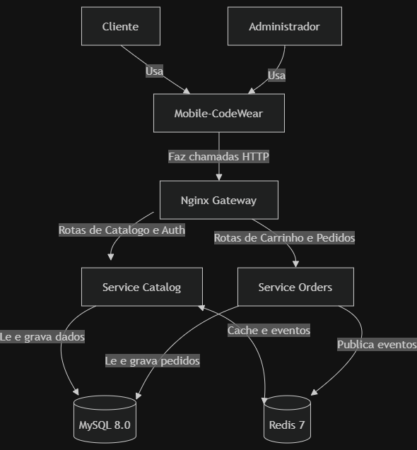
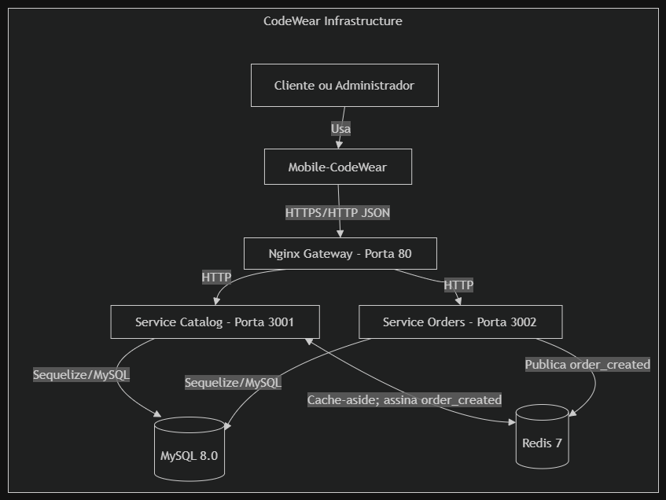
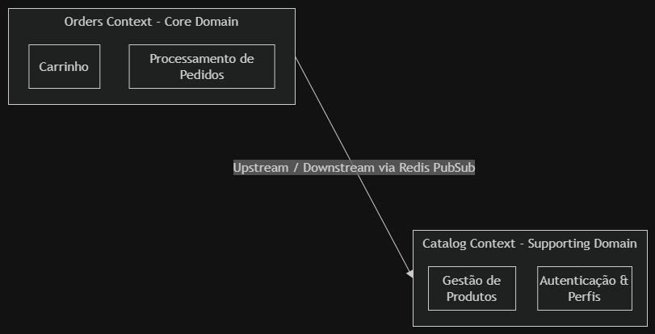

# CodeWear Architecture

## 1. C4 diagrams

### C1 — System context

### C2 — Containers

> **Portas em execução:** o diagrama C2 acima registra as portas solicitadas na
> rubrica. No `docker-compose.yml` e na configuração Nginx atuais, o gateway
> publica/escuta `8080:8080`, o Service Catalog escuta `3000` e o Service Orders
> escuta `3001`. MySQL (`3306`) e Redis (`6379`) são acessíveis somente na rede
> interna do Compose. Os dois microsserviços atualmente usam a mesma instância
> e o mesmo banco MySQL; a separação de domínio é feita no nível dos serviços,
> não por bancos fisicamente isolados.

## 2. ADRs

### ADR 001 — Architectural style

### Adoção de Arquitetura de Microsserviços Desacoplados com NestJS e Redis Pub/Sub

- **Status:** Aceito
- **Contexto e problema:** É necessário isolar os domínios de Catálogo e Pedidos
  para reduzir o acoplamento entre responsabilidades e permitir escalabilidade
  independente dos serviços.
- **Decisão:** Separar a aplicação em `service-catalog` e `service-orders`,
  ambos implementados com NestJS. Usar Redis Pub/Sub para comunicação assíncrona
  por eventos entre os serviços, incluindo `order_created`.
- **Consequências:** A separação favorece independência de deploy e escalabilidade
  dos serviços. A complexidade adicional de execução é gerenciada com Docker
  Compose, que orquestra os serviços e a infraestrutura compartilhada. Como os
  dois serviços ainda usam o mesmo banco MySQL, o isolamento de dados permanece
  lógico e não elimina todo o acoplamento no schema.

### ADR 002 — Escolha de Armazenamento e Persistência de Dados

- **Status:** Aceito
- **Contexto e problema:** A aplicação precisa armazenar dados relacionais
  estruturados — como produtos, pedidos e usuários — com suporte a transações
  ACID, além de um mecanismo de alta velocidade para cache e eventos assíncronos.
- **Decisão:** Adotar **MySQL 8.0** como banco relacional para a persistência
  principal de `service-catalog` e `service-orders`. Adotar **Redis 7** como
  camada de cache-aside para consultas de produtos e como broker Pub/Sub para a
  comunicação assíncrona do evento `order_created`.
- **Consequências:** As transações do checkout mantêm consistência ao criar o
  pedido e seus itens e atualizar o estoque; o cache Redis pode acelerar
  consultas de produtos. Como trade-off, os microsserviços compartilham
  atualmente a mesma instância e o mesmo banco MySQL, com separação lógica por
  domínio. Isso exige governança para evitar acoplamento no schema e nos dados.

## 3. Quality scenarios

| Atributo | Estímulo e ambiente | Resposta esperada | Medida / critério |
|---|---|---|---|
| Desempenho | Um cliente consulta produtos enquanto o serviço está operando normalmente e as páginas do catálogo estão aquecidas no cache. | O Service Catalog atende a consulta pelo cache-aside Redis, sem precisar consultar o MySQL para a página em cache. | Latência da busca inferior a 100 ms. Este é um objetivo de qualidade; não há benchmark documentado que comprove o limite em todos os ambientes. |
| Disponibilidade | Redis fica temporariamente indisponível durante a publicação de `order_created`. | O pedido permanece persistido; a aplicação registra a falha e responde com erro. Este comportamento reflete o código atual, que não possui fallback durável para o evento. | Objetivo de evolução: recuperar a publicação sem perda e sem retorno ambíguo ao cliente; ainda não garantido pela implementação atual. |

**Estado atual do cenário de disponibilidade:** o cliente Redis utiliza o
comportamento padrão de reconexão da biblioteca, mas não há fallback durável
(como outbox/fila persistente) implementado. Atualmente, a falha ao publicar
`order_created` é registrada e a API retorna erro mesmo após o pedido já ter
sido persistido. Portanto, o cenário de disponibilidade acima é um requisito
alvo, não uma garantia já atendida integralmente. Redis Pub/Sub também não
reproduz mensagens publicadas enquanto o assinante está desconectado.

## 4. Estilos Arquiteturais e Domain-Driven Design (DDD)

### 4.1 Context Map

### 4.2 Mapeamento de Domínios e Bounded Contexts

#### 1. Orders Context (Core Domain)

- **Tipo de domínio:** Core Domain, conforme a classificação adotada no
  Context Map.
- **Responsabilidades:** gerenciar linhas do carrinho, processar checkout e
  criar/consultar pedidos.
- **Linguagem encontrada no código:** `Cart`, `CheckoutDto`, `Order`,
  `OrderItem` e o evento `order_created` (payload com `event` e `orderId`).
  Não existe classe `CartItem` nem evento/classe `OrderCreated` no código.

#### 2. Catalog Context (Supporting Domain)

- **Tipo de domínio:** Supporting Domain, conforme a classificação adotada no
  Context Map.
- **Responsabilidades:** cadastrar e listar produtos, manter estoque, tamanhos
  e promoções, além de autenticação e perfis.
- **Linguagem encontrada no código:** `Product`, `ProductSize`, `Promotion` e
  `User`. `category` é um atributo textual de `Product`, não uma entidade
  `Category`. Não foram encontrados modelos ou tipos `SKU`, `AuthToken` ou
  `StockCache`; o JWT é tratado como token de autenticação, o cache usa chaves
  Redis e os produtos não têm um atributo `SKU` declarado nos models.

### 4.3 Elementos táticos do contexto Orders

O backend usa models Sequelize para persistência. Esta seção distingue os
conceitos de modelagem DDD da implementação atual: não foram adicionadas classes
de domínio ou alterações ao código.

#### Aggregates (Agregados)

- **Agregado de Pedidos — conceitual:** `Order` funciona conceitualmente como a
  raiz do agregado e `OrderItem` como entidade pertencente ao pedido. O model
  declara a relação `HasMany`, e o checkout cria o pedido e seus itens dentro
  de uma transação Sequelize.
- **Limite da implementação:** não existe uma classe `OrderAggregate` ou
  `OrderAggregateRoot`, e as regras de consistência não estão encapsuladas em
  uma camada de agregado DDD. A transação de checkout é a garantia de
  consistência atualmente implementada.
- Cada registro de `Cart` representa um item associado a `userId`, `productId`,
  `quantity` e `size`; não existe entidade/tipo `CartItem` separado nem
  agregado `Cart` contendo uma coleção de itens. Portanto, `Cart` não é
  documentado aqui como um agregado formal.

#### Entities (Entidades)

- **`Order`:** model da tabela `orders`; possui `id`, `totalValue`, `status`,
  `paymentMethod`, `address` e `userId`, além dos timestamps do Sequelize. O
  status tem valor padrão `pendente`; o checkout define `pago`. O campo é uma
  string, sem enum nem regras de transição implementadas no model.
- **`OrderItem`:** model da tabela `order_items`; possui `id`, `quantity`,
  `priceAtPurchase`, `orderId`, `productId` e `size`.
- **`Cart`:** model da tabela `carts`; possui `id`, `quantity` (padrão `1`),
  `userId`, `productId` e `size`. Cada linha associa um usuário a um produto.
- **`Product`:** model da tabela `products`; possui `id`, `name`, `price`,
  `description`, `category`, `stock`, `image_url` e `isVisible`.
- **`ProductSize`:** model da tabela `product_sizes`; possui `id`, `productId`,
  `size` e `stock`.
- **`Promotion`:** model da tabela `promotions`; possui `id`, `code`,
  `discountPercentage`, `validFrom`, `validUntil`, `isActive` e `productId`.
- **`User`:** model de autenticação/perfil em `service-catalog`, com `id`,
  `name`, `email`, `cpf`, `password`, `role`, `phone`, `address`, `avatarUrl` e
  `isActive`. `service-orders` também declara um model `User` reduzido a `id` e
  `name`/`email` para suas associações.

#### Value Objects (Objetos de Valor)

- **Conceitos propostos para evolução da modelagem:** `Money`, para valores
  monetários, e `Address`, para o endereço de entrega, poderiam ser Value
  Objects no contexto Orders. São propostas conceituais, não tipos existentes
  nem comportamento implementado.
- **Implementação atual:** `Order.totalValue` e
  `OrderItem.priceAtPurchase` são persistidos como `DECIMAL(10, 2)`; `Order.address`
  e `Order.paymentMethod` são strings; `Order.status` também é string; e as
  quantidades são inteiros nos models Sequelize. Não existem classes Value
  Object dedicadas para dinheiro, endereço, quantidade ou status. `CheckoutDto`
  apenas valida os campos de entrada e não é um Value Object de domínio.

## 5. Atributos de Qualidade, Resiliência e Observabilidade

### 5.1 Objetivos e Indicadores de Nível de Serviço (SLOs e SLIs)

Os valores abaixo são **objetivos propostos**, não SLOs medidos ou garantidos
pela implementação atual. Não há coleta contínua de métricas ou relatório de
SLO configurado no projeto.

| Indicador (SLI) | Objetivo (SLO) | Critério de medição / estado atual |
| :--- | :--- | :--- |
| **Tempo de resposta (`GET /products`)** | 95% das requisições abaixo de 100 ms | Objetivo a medir pela latência HTTP. NestJS registra duração por requisição; não há agregação de percentis nem benchmark configurado. O cache-aside Redis registra a origem `CACHE` ou `DATABASE`. |
| **Taxa de sucesso de checkout (`POST /checkout`)** | Pelo menos 99% das tentativas concluídas com sucesso | Objetivo a medir pela proporção de respostas HTTP 201. O projeto não agrega atualmente tentativas e sucessos como métrica. |
| **Disponibilidade da API** | 99,5% de uptime mensal | Objetivo a medir externamente. Não foram identificados endpoints de health para os serviços NestJS nem monitoramento mensal de disponibilidade. O Compose tem health checks para MySQL e Redis. |

### 5.2 Estratégias de Resiliência Aplicadas

1. **Redis e cache de produtos:** o cliente Redis usa a configuração padrão da
   biblioteca; o projeto não define explicitamente uma política de retry ou
   backoff exponencial. Se a leitura do cache falhar, `GET /products` registra
   um aviso e consulta o MySQL; falhas ao gravar o cache também são registradas
   sem impedir a resposta da consulta.
2. **Transação de checkout:** criação de `Order` e `OrderItem`, decremento do
   estoque e remoção dos itens do carrinho ocorrem numa transação Sequelize.
   Erros durante essas operações provocam rollback. A publicação Pub/Sub ocorre
   após o commit; se ela falhar, o pedido permanece persistido e a API retorna
   erro, sem outbox ou fallback durável.
3. **Timeouts do Nginx:** não há diretivas de timeout de proxy configuradas no
   `nginx.conf` atual. Portanto, timeouts rigorosos de leitura/escrita não são
   uma proteção implementada neste momento.
4. **Degradação do catálogo:** a falha na leitura do Redis permite consultar o
   MySQL como fallback. Essa degradação cobre o cache de produtos; não implica
   que todas as operações que dependem de Redis, em especial a publicação de
   eventos, tenham fallback.

### 5.3 Plano Simples de Observabilidade

#### 1. Logs disponíveis

- **Acesso HTTP no NestJS:** `configureHttp` registra método, caminho, status e
  duração em milissegundos. Não registra tamanho do payload e não foi
  identificada configuração de log de acesso equivalente no Nginx.
- **Cache do catálogo:** `ProductsService` registra `source=CACHE` em cache hit,
  `source=DATABASE` na leitura do banco e avisos quando operações do Redis
  falham.
- **Eventos Pub/Sub:** publicador e assinante registram o evento
  `order_created` e seu payload após publicar ou validar/receber a mensagem.
  Esses logs não constituem uma fila durável nem confirmação transacional.

#### 2. Métricas e saúde

- O código registra logs operacionais, mas não inclui atualmente um exportador
  de métricas ou dashboard para taxas HTTP 5xx, percentis de latência ou taxa de
  sucesso de checkout.
- Docker Compose define health checks para `mysql` e `redis`; não define
  health checks para `service-catalog`, `service-orders` ou `nginx`.
- Consumo de CPU e memória dos contêineres pode ser inspecionado pelas
  ferramentas do Docker, mas não há coleta ou monitoramento contínuo desses
  indicadores configurado no projeto.
